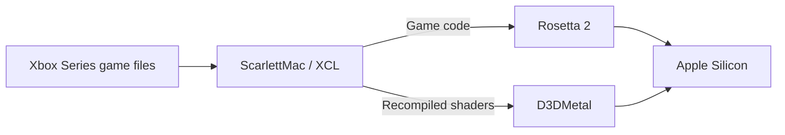

# ScarlettMac

Xbox Series X|S compatibility research for Apple Silicon, built on [XCL](https://github.com/xcl-dev/xcl).

> [!NOTE]
> GTA VI boots offline, shows the intro and menus, and starts loading the world. The first playable scene is still unverified.

[How it works](#how-it-works) · [What works on Mac](#what-works-on-mac) · [GTA VI status](#gta-vi-status) · [Build and run](#build-and-run)

## How it works



CrossOver runs the Windows x64 runtime on macOS. XCL supplies the Xbox system APIs and recompiles console GPU shaders to DXIL for D3DMetal.

## What works on Mac

Latest measurements used an Apple M3 Max, CrossOver Preview 27.0.0.41073, and D3DMetal 4.0b3.

| Test | Observed result |
| --- | --- |
| Offline Xbox runtime | Boots the Xbox Series version of GTA VI from local files. |
| Graphics and frame output | 11 of 11 checks passed in each synthetic test run. |
| Full Xbox system fixture | 43 of 50 checks passed all three runs. One varied and six failed all three. |
| TuxBox Lanes | Completed the scripted game replay with input, collisions, and rendered-board checks. |

<details>
<summary>Open fixture checks and reproduction</summary>

| Check | Subsystem | Observed result |
| --- | --- | --- |
| 11 | Window handling | Windows reported that the console window was uncloaked. |
| 37 | DMA and title memory | The copy read the title's memory in one of three runs. |
| 38 | GPU command list | Reading back a bottom-of-pipe 32-bit write returned zero. |
| 39 | Sparse GPU memory | The GPU saw a stale value after a CPU write to a mapped buffer. |
| 40 | Coherent memory | Reading back two values from the write-back buffer returned zeros. |
| 41 | Sparse uploads | The first ring-buffer upload returned different bytes than expected. |
| 46 | DirectStorage | The read did not signal the test's D3D12 fence. |

[Reproduce the compatibility checks](#reproduce-the-compatibility-checks) · [Reproduce the TuxBox Lanes replay](#reproduce-the-tuxbox-lanes-replay)

</details>

## GTA VI status

Series build 1.0.2.1 on the Mac test setup above.

| Stage | Result |
| --- | --- |
| Offline boot | Verified |
| Intro graphics | Verified |
| Setup and menus | Verified at about 30 FPS with controller input |
| World loading | Verified through loading artwork and asset reads |
| Visible 3D scene | Open |
| In-world controls | Open |
| First mission | Open |

## Current work

The latest Series X replay captured a black frame after 150 seconds. GPU submissions continued and D3DMetal reported up to **16.8 GiB** of video memory.

| Measurement | Earlier | Later |
| --- | ---: | ---: |
| Shaders using fallback, same 723 variants | 88 | 4 |
| Failed game-data reads in two runs | 494 of 87,151 | 0 of 87,242 |
| Time to prepare the same two GPU pipelines offline | 25.1 s | 0.3 s with a warm cache |

<details>
<summary>Technical results and ongoing work</summary>

| Area | What we measured | What we're testing |
| --- | --- | --- |
| Shader translation | Structured loops reduced fallback from 88 to 4 across the same 723 shader variants. Packed tables let both large compute pipelines finish on the Mac. The larger D3DMetal build took 42.6 seconds. | Trace the rendering wait that persists after both pipelines complete. [Structured loops](https://github.com/ivall/xcl/commit/b8b1f491ea5e075a82293f6ebefd8eceffc74de7) · [Packed tables](https://github.com/ivall/xcl/pull/1448) |
| Render scheduling | The Wait64 ordering regression passed on Windows WARP and CrossOver D3DMetal. With the fix disabled on WARP, the first copy timed out. In a 168-second offscreen run, the game drew black after the loading artwork and logged 2,962 PresentX calls in total. All 16 sampled pipeline builds and 16 sampled binds returned. | Capture the native queue calls at the world-load stall. [XCL ordering change](https://github.com/xcl-dev/xcl/pull/851) |
| Pipeline creation | In two cold CPU-only comparisons on the same three world-loading shaders, descriptor-heap memory windows reduced mean DXC compile time from 46.8 to 42.4 seconds and total DXIL size by 8.8%. | Measure D3DMetal's native pipeline build time separately. [XCL change](https://github.com/xcl-dev/xcl/pull/680) |
| Pipeline cache | In a generated compute benchmark, D3DMetal took about 5.1 seconds on the first creation and 2 to 3 ms in later processes. Precompiling three selected GTA VI compute pipelines took 44.5 seconds. The next game run logged 3,208 presents and 89,065 storage requests with zero reported storage failures. The last captured frame was black. | Compare driver compile times with descriptor-heap memory windows enabled and disabled in the same build. [Windows warm-cache result](https://github.com/xcl-dev/xcl/issues/534#issuecomment-7138554827) |
| World-load shaders | Five shader variants from the trace precompiled into D3DMetal pipelines in 18.8 seconds. The warmed run reached 3,498 PresentX calls and its last capture showed loading artwork. The later Rosetta-fixed run logged bind times of up to 19.6 seconds for graphics and 13.6 seconds for compute. | Identify which compile stages account for the late bind delays. |
| Late compute cache | Prepared six shaders offline in 18.9 seconds. A repeat loaded all six cached results in 0.1 seconds. The warmed offscreen game run still reached the watchdog at 167.0 seconds on loading artwork. A separate compute pipeline took 15.55 seconds for shader preparation and 13.3 ms for native creation during that run. | Cover more of the shaders requested during world loading. |
| Graphics shader preparation | In the warmed game run, a sampled pixel shader took 2.35 seconds to prepare. Native graphics pipeline creation stayed below 3.8 ms across the traced graphics pipelines. The paired offline precompiler filled two missing shader entries. A subsequent test reused all 22 cached shaders in a pack of 11 pairs from the trace. | Test the larger cache during another offscreen world load. |
| Pipeline preload priority | All 15 selected pipelines were ready before account selection in the offscreen game run. The prior 26.9 seconds of waits on those keys did not recur in the traced window. Cache contents and scheduling both changed. Five different graphics binds waited a combined 14.7 seconds. The last capture still showed loading artwork. | Retest with the additional five pipelines cached. |
| Guest semaphore publication | In the 20-pipeline run, five delayed guest values were written 21 to 145 ms after their native fences were observed complete. Submissions still stopped after those stores. | Check the later compute pipeline stalls. |
| Late compute pipelines | Two compute pipelines that previously stalled world loading were ready before account selection. In the latest replay they built in 90 ms and 84 ms. The preload worker built all 22 selected pipelines before account selection. | Check other pipelines requested during the first world render. |
| World-load memory | The earlier memory guard stopped the offscreen run at 169.2 seconds. The latest replay tracked 9,412 MiB of texture pages in use with no whole free texture heaps at its last memory sample. | Track texture residency through world loading. |
| Series S profile | The title submitted two display planes. The earlier captures sampled its 1080p plane, which was black. | Check the other display plane for the startup image. |
| macOS memory reporting | A title query treated about 255 GiB of reserved virtual address space as private usage. The corrected Series S query reported 5.6 GiB in use against an 8 GiB budget. An isolated CrossOver test verified reservation and resident-memory accounting. | Track usage during world loading. [Wine process counters](https://raw.githubusercontent.com/wine-mirror/wine/master/dlls/ntdll/unix/process.c) |
| Ray-tracing memory | In a synthetic D3DMetal test, a shader read both successive CPU writes through the coherent shadow. An opt-in build routed a 2,199 MiB retail allocation through the same path. The 194-second run logged the Rosetta float-to-half store error before GPU submissions stopped on loading artwork. | Test the replacement store during world loading. |
| DirectStorage | A focused CPU test reproduced a read starting before its destination page list was ready. The queue change passed the byte-for-byte check. A combined shader and storage build logged zero failures across 87,082 requests and still stopped on loading artwork. | Verify that the fix holds across repeated world loads. [Upstream queue fix](https://github.com/ivall/xcl/pull/549) |
| DirectStorage on D3DMetal | Fixed a valid fence being rejected. In a separate 64 KiB zlib test, an early-queued GPU command read stale bytes with shadow synchronization disabled and the correct bytes with it enabled. The retail test streamed assets, then Rosetta stopped at a float-to-half memory store. | Verify the first rendered world frame with the corrected memory path. |
| Rosetta float-to-half stores | The build replaced 70 stores, including the one that repeatedly stopped the title. Three CrossOver tests passed, including write-watch recovery across two pages. The offscreen retail run advanced beyond that failure and reached the game's GPU watchdog at 167.6 seconds. | Identify the GPU dependency that stalls world loading. |

</details>

## Mullion fallback

Mullion v0.5-alpha.4 ran in a separate CrossOver bottle. It passed 48 of 50 synthetic checks and let the GPU read XCL's imported host memory directly. After fixes for command-list creation and console render-target descriptors, the title advanced to black offscreen captures through frame 290. A Metal GPU write fault then caused device removal. [Mullion release](https://github.com/dttdrv/mullion/releases/tag/v0.5-alpha.4)

## Parallels fallback

The retail launcher read the game from a read-only SSD share in Windows 11 Arm. This VM exposed neither the required CPU instruction set nor the 32- or 64-lane shader waves required by XCL. Its WARP adapter reported 4-lane waves. The launch stopped at those checks.

## Build and run

Use an Apple Silicon Mac with CrossOver Preview and create a dedicated Windows 11 64-bit bottle named `ScarlettLab` with D3DMetal enabled. Keep the executable and accompanying unpacked game files together in their original directory structure. [CrossOver](https://www.codeweavers.com/crossover)

Install Rust through rustup, extract LLVM-MinGW 20261117 for macOS, and extract the x64 DLLs from a DirectX Shader Compiler release. The reported build used Rust 1.92.0. [Rust](https://rustup.rs/) · [LLVM-MinGW](https://github.com/mstorsjo/llvm-mingw/releases/tag/20261117) · [DXC](https://github.com/microsoft/DirectXShaderCompiler/releases)

```sh
rustup target add --toolchain stable x86_64-pc-windows-gnullvm
export SCARLETT_LLVM_MINGW=/path/to/llvm-mingw
export SCARLETT_DXC_DIR=/path/to/dxc/bin/x64
scripts/build.sh
scripts/run.sh --inspect /path/to/unpacked/game.exe
scripts/run.sh /path/to/unpacked/game.exe
```

Set `SCARLETT_BOTTLE_DIR` to use a dedicated bottle in another location. Set `SCARLETT_OPUS_DLL` to an x64 `libopus-0.dll` to enable the Opus decoder. The launcher stores local data in the bottle under `C:\scarlett-lab-data` and runs with outbound IP traffic disabled.

The repository distributes project source, patches, and launcher scripts. Supply your own unpacked game files. [Source provenance](SOURCE-NOTICES.md)

## Reproduce the compatibility checks

Build XCL's synthetic Xbox Series test title from source and run it in the same bottle. Each test run gets fresh state because the fixture exercises file deletion. The process exits with the number of failed checks. Our clean runs exited with 6 or 7 failures, with one intermittent GPU-memory check accounting for the difference.

```sh
scripts/build.sh --test-title
scripts/run.sh --test-title
```

## Reproduce the TuxBox Lanes replay

Build Lanes from the pinned TuxBox revision and place `lanes.exe` and the original `MicrosoftGame.config` in their own directory. Use the TuxBox build requirements to produce the executable. ScarlettMac supplies the Xbox interfaces for this run. [TuxBox Lanes source and build guide](https://github.com/brcly/TuxBox/tree/3086e0b0451aafb7d74dac44b1ebf7786bea06d4/examples/lanes)

```sh
scripts/build.sh --lanes
scripts/run.sh --lanes /path/to/lanes/lanes.exe -- --replay
```

The replay runs without a window and reports `course=16/16 win=16/16 safe-miss=1 collision=1 frames=2 input=gameinput` on success. The Lanes build enables host compute and native committed buffers for this test.

## Report a result

Include your Mac model, macOS version, CrossOver Preview version, project commit, and the last screen or operation that worked. Share sanitized logs and reproduction steps.

## Credits and license

This project builds on XCL by ivall and the macOS work by utkarshxdev. [ivall/xcl](https://github.com/ivall/xcl), [utkarshxdev/xcl-mac](https://github.com/utkarshxdev/xcl-mac)

The XCL-derived patches are distributed under GPL-2.0-only. See [LICENSE](LICENSE).
