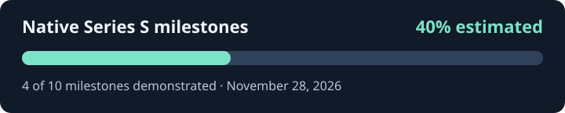
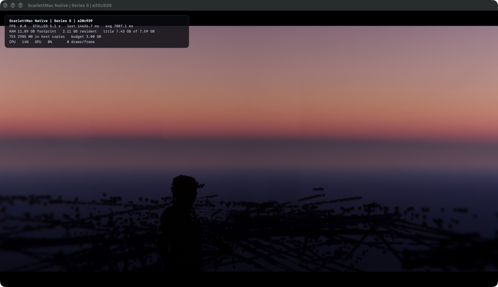
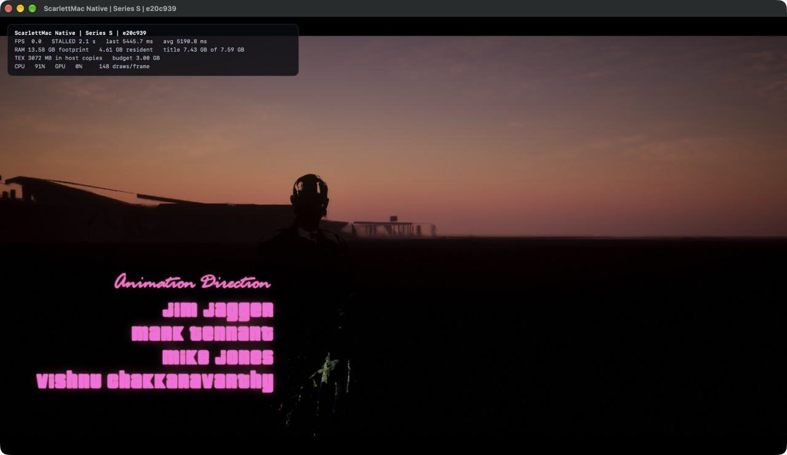
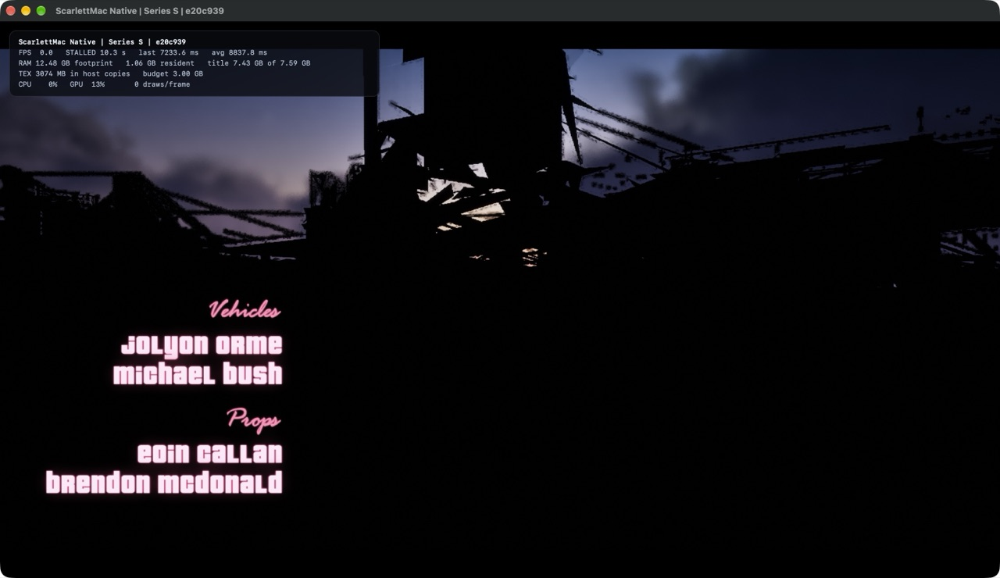
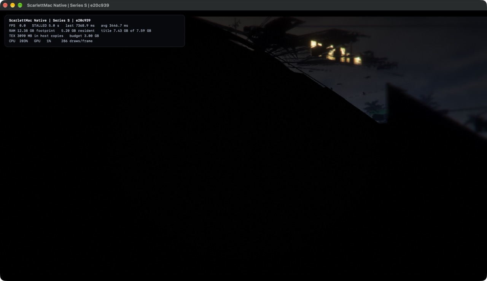
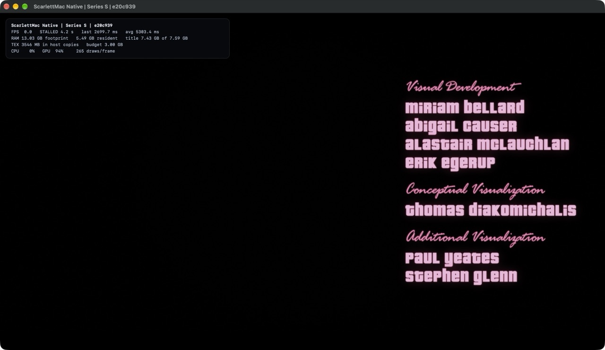

# ScarlettMac Native

Native Xbox Series S runtime for Apple Silicon Macs. No Wine, CrossOver or D3DMetal: it runs the title's x86-64 code through Rosetta, implements Xbox and Windows services in Rust, and sends graphics work directly to Metal.

> [!IMPORTANT]
> **The native runtime reaches the Series S opening. Gameplay is still unavailable.** Models can stretch or break, lighting is incomplete, and world frame times are still too high for play.

[Build the native runtime](#build-the-native-runtime) · [Apple Silicon specs and FPS estimates](docs/apple-silicon.md) · [Native run details](docs/native-series-s.md)

## Native Series S progress



The bar counts ten equally weighted milestones. It tracks verified outcomes and gives no release date.

| Demonstrated · 4 | Open · 6 |
| --- | --- |
| Native boot, menus and input, loading the opening, presenting world frames | Correct models, correct lighting and shadows, roughly 8 GiB footprint, sustained 5 FPS in the opening, stable world runs across repeats, verified gameplay controls |

In the latest measured native opening on the **18 GiB M3 Pro**, one world interval averaged **745 ms/frame (1.34 FPS)** and the last sampled process footprint was **11.48 GiB**. The included snapshot carries a newer light-list shader fix, an index trace for stretched geometry, and a texture refresher cap. See the [run details](docs/native-series-s.md) for what each change has verified so far.

## Build the native runtime

Use an Apple Silicon Mac with macOS 15 or later, Rosetta, Xcode command-line tools, rustup, and Apple's Metal Shader Converter 3.0 or later. Supply your own legally obtained game files and keep them outside the checkout. [Metal Shader Converter](https://developer.apple.com/metal/shader-converter/)

```sh
git clone https://github.com/AeroUp/scarlettmac-native.git
cd scarlettmac-native/native-runtime
tools/macos/native-setup.sh
tools/macos/run-native.sh --console series-s /path/to/your/game/folder
```


## Native status

<p align="center">
  
  
  
  
</p>

| Area | Status on the 18 GB M3 Pro |
| --- | --- |
| Boot, menus, input | ✅ Works |
| Loading the opening | ✅ Works |
| Presenting world frames | ✅ Works, in a window, 720p internal with MetalFX upscale |
| Frame rate | 🟥 About 1.3 FPS at best in the world (745 ms/frame), target 5 FPS |
| Memory | 🟨 8.0–11.5 GB footprint, target about 8 GB like the console |
| Models | 🟥 Stretched, "stringy" geometry; index trace in progress |
| Lighting and shadows | 🟥 Mostly dark; shadow maps draw, but lighting drops them |
| Dropped draws | 🟨 About 5% with a warm shader cache |
| Stability | 🟨 Runs of 8–14 minutes; some end on the game's 30-second watchdog |
| Gameplay | 🟥 Not reached |

## Screenshots from native runs

All captured on an M3 Pro (18 GB) running the Series S profile in a window, November 27–28, 2026. The overlay in the top left is the run HUD (F3).

<table>
  <tr>
    <td width="50%" align="center"><a href="assets/native/sunset-silhouette.jpg"></a><br><strong>Opening at 10 minutes</strong><br>Sky renders; the ground and character are still unlit.</td>
    <td width="50%" align="center"><a href="assets/native/credits-horizon.jpg"></a><br><strong>Opening credits over the horizon</strong><br>12.5 minutes in, no crash.</td>
  </tr>
  <tr>
    <td align="center"><a href="assets/native/industrial-dusk.jpg"></a><br><strong>Industrial skyline</strong><br>Geometry draws, but lighting is missing.</td>
    <td align="center"><a href="assets/native/night-town.jpg"></a><br><strong>Night town</strong><br>Lit windows show; the foreground stays black.</td>
  </tr>
  <tr>
    <td colspan="2" align="center"><a href="assets/native/black-world.jpg"></a><br><strong>The black-world bug</strong><br>Before the light-list shader fix, the world behind the credits was black.</td>
  </tr>
</table>

## Credits and license

This is a fork of [paveledits/ScarlettMac](https://github.com/paveledits/ScarlettMac). Its CrossOver/XCL builds and their captures live upstream; the `patches/` and `runtime-preview/` folders are kept from it. The native runtime builds on [VIctory-macOS](https://github.com/pragyaangaur/VIctory-macOS), XCL by [ivall](https://github.com/ivall/xcl) and macOS work by [utkarshxdev](https://github.com/utkarshxdev/xcl-mac).

The XCL-derived patches use [GPL-2.0-only](LICENSE). The runtime preview and native runtime use [GPL-3.0-or-later](runtime-preview/LICENSE). See [source notices](SOURCE-NOTICES.md).
