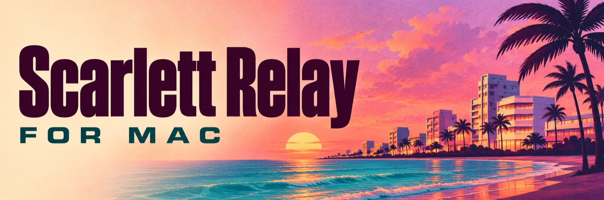
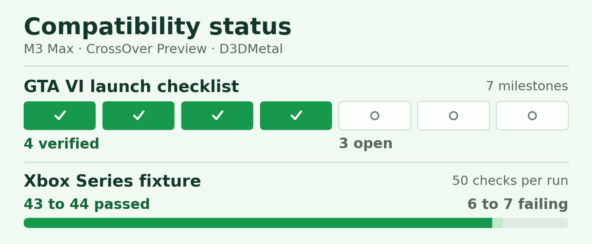
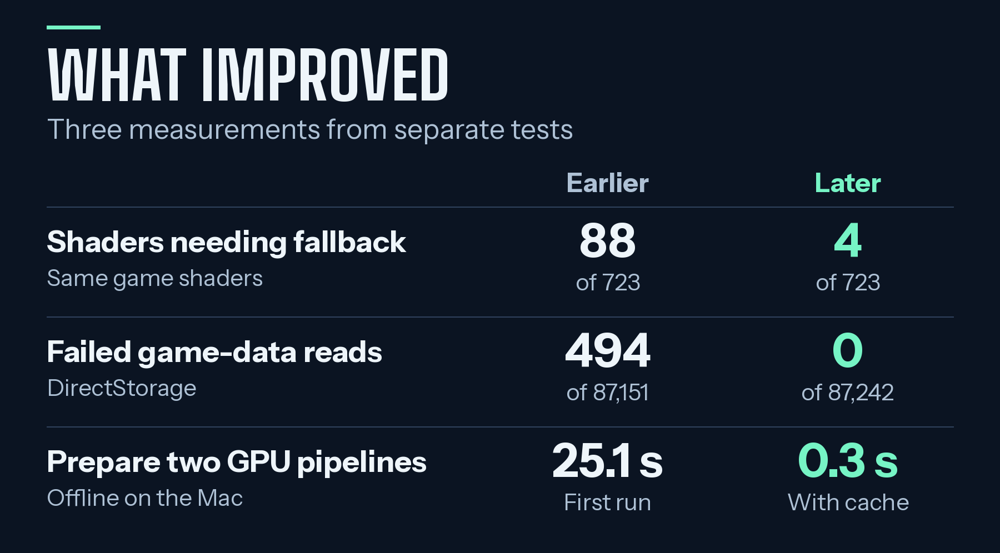

Scarlett Relay is an experimental compatibility layer built on XCL. It runs locally on Apple Silicon through CrossOver Preview and D3DMetal.

[GTA VI status](#gta-vi-status) · [Current work](#current-work) · [Build and run](#build-and-run)



## GTA VI status

**The first mission is still blocked during world loading.** The checklist tracks observed stages for Xbox Series build 1.0.2.1 on an Apple M3 Max with CrossOver Preview 27.0.0.41073 and D3DMetal 4.0b3.

| Milestone | Status | Observed on Mac |
| --- | --- | --- |
| Offline boot | Verified | The Xbox Series executable starts offline. |
| Intro | Verified | The opening graphics render. |
| Setup and menus | Verified | Controller input works through setup. Menus render at about 30 FPS. |
| World loader | Verified | The game draws loading artwork and reads world assets. |
| Live 3D scene | Open | The 11-minute packed-shader test still ended on loading artwork. |
| Gameplay input | Open | In-world movement and camera control await a rendered scene. |
| First mission | Open | A playable run through the first mission remains unverified. |

## Verified on Mac

The last three clean XCL fixture runs passed **43, 44, and 43 of 50 checks**, including GPU rendering and frame presentation. Sparse buffer readback and a DirectStorage fence still fail. [Reproduce the compatibility checks](#reproduce-the-compatibility-checks)

**TuxBox Lanes** completed its scripted replay with the optional Lanes build. The game checked all 16 GPU-generated course rows, a winning run, a missed coin, a collision, and two rendered boards by pixel readback. [Reproduce the TuxBox Lanes replay](#reproduce-the-tuxbox-lanes-replay)

## Current work

Local experiments on the M3 Max, updated 24 November 2026.



| Area | What we measured | What we're testing |
| --- | --- | --- |
| Shader translation | Structured loops reduced fallback from 88 to 4 across the same 723 shader variants. In the latest game test, packed tables let both large compute pipelines finish on the Mac. The larger D3DMetal build took 42.6 seconds. | Trace the rendering wait that persists after both pipelines complete. [Structured loops](https://github.com/ivall/xcl/commit/b8b1f491ea5e075a82293f6ebefd8eceffc74de7) · [Packed tables](https://github.com/ivall/xcl/pull/1448) |
| Pipeline creation | Prioritizing four selected pipelines started their builds around nine to ten seconds into the run. One still waited for the single background compile slot through the six-minute cap. The last frame was loading artwork. | Test a smaller shader form for the largest compute pipelines. |
| Pipeline cache | In a generated compute benchmark, D3DMetal took about 5.1 seconds on the first creation and about 2 to 3 ms in later processes. Loading an explicit pipeline library was also in that range. | Measure how much of the default driver cache behavior carries over to the game's larger pipelines. |
| DirectStorage | A focused CPU test reproduced a read starting before its destination page list was ready. The queue change passed the byte-for-byte check. The chart shows two individual retail runs, both of which stalled on loading artwork. | Check whether later runs also complete storage requests cleanly and whether that changes the loading outcome. [Upstream queue fix](https://github.com/ivall/xcl/pull/549) |

## Build and run

Use an Apple Silicon Mac with CrossOver Preview and create a dedicated Windows 11 64-bit bottle named `ScarlettLab` with D3DMetal enabled. Keep the executable and accompanying unpacked game files together in their original directory structure. [CrossOver](https://www.codeweavers.com/crossover)

Install Rust through rustup, extract LLVM-MinGW 20261117 for macOS, and extract the x64 DLLs from a DirectX Shader Compiler release. The reported build used Rust 1.92.0. [Rust](https://rustup.rs/) · [LLVM-MinGW](https://github.com/mstorsjo/llvm-mingw/releases/tag/20261117) · [DXC](https://github.com/microsoft/DirectXShaderCompiler/releases)

```sh
rustup target add --toolchain stable x86_64-pc-windows-gnullvm
export SCARLETT_LLVM_MINGW=/path/to/llvm-mingw
export SCARLETT_DXC_DIR=/path/to/dxc/bin/x64
scripts/build.sh
scripts/run.sh --inspect /path/to/unpacked/game.exe
scripts/run.sh /path/to/unpacked/game.exe
```

Set `SCARLETT_BOTTLE_DIR` to use a dedicated bottle in another location. Set `SCARLETT_OPUS_DLL` to an x64 `libopus-0.dll` to enable the Opus decoder. The launcher stores local data in the bottle under `C:\scarlett-lab-data` and runs with outbound IP traffic disabled.

The repository distributes project source, patches, and launcher scripts. Supply your own unpacked game files. [Source provenance](SOURCE-NOTICES.md)

## Reproduce the compatibility checks

Build XCL's synthetic Xbox Series test title from source and run it in the same bottle. Each test run gets fresh state because the fixture exercises file deletion. The process exits with the number of failed checks. Our clean runs exited with 6 or 7 failures, with one intermittent GPU-memory check accounting for the difference.

```sh
scripts/build.sh --test-title
scripts/run.sh --test-title
```

## Reproduce the TuxBox Lanes replay

Build Lanes from the pinned TuxBox revision and place `lanes.exe` and the original `MicrosoftGame.config` in their own directory. Use the TuxBox build requirements to produce the executable. Scarlett Relay supplies the Xbox interfaces for this run. [TuxBox Lanes source and build guide](https://github.com/brcly/TuxBox/tree/3086e0b0451aafb7d74dac44b1ebf7786bea06d4/examples/lanes)

```sh
scripts/build.sh --lanes
scripts/run.sh --lanes /path/to/lanes/lanes.exe -- --replay
```

The replay runs without a window and reports `course=16/16 win=16/16 safe-miss=1 collision=1 frames=2 input=gameinput` on success. The Lanes build enables host compute and native committed buffers for this test.

## Report a result

Include your Mac model, macOS version, CrossOver Preview version, project commit, and the last screen or operation that worked. Share sanitized logs and reproduction steps.

## Credits and license

This project builds on XCL by ivall and the macOS work by utkarshxdev. [ivall/xcl](https://github.com/ivall/xcl), [utkarshxdev/xcl-mac](https://github.com/utkarshxdev/xcl-mac)

The XCL-derived patches are distributed under GPL-2.0-only. See [LICENSE](LICENSE).
