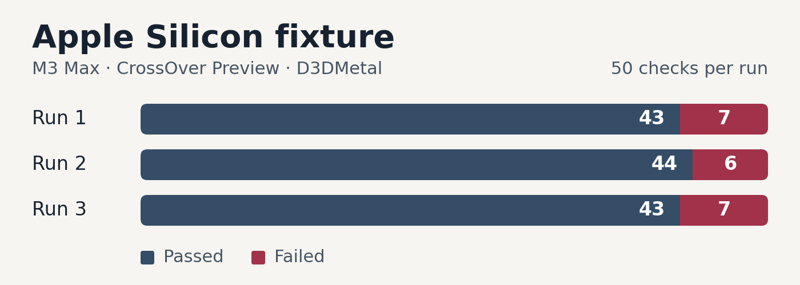

# Scarlett Relay

Experimental Xbox Series X|S compatibility for Apple Silicon. Scarlett Relay builds on XCL and runs locally through CrossOver Preview and D3DMetal.

[GTA VI status](#gta-vi-status) · [Current work](#current-work) · [Build and run](#build-and-run)

## GTA VI status

**World loading reached. The first mission is still blocked.** Tested on the Xbox Series 1.0.2.1 build with an Apple M3 Max, CrossOver Preview 27.0.0.41073, and D3DMetal 4.0b3.

| Milestone | Observed on Mac |
| --- | --- |
| Boot and intro | The executable starts offline and renders the intro. |
| Setup and menus | Controller input works through setup. Menus render at about 30 FPS. |
| World loading | Loading artwork renders while the game streams assets and builds GPU pipelines. |
| First mission | The nine-minute shader test ended on loading artwork. Presentation stalled and the title's watchdog fired. |

## Verified on Mac



The XCL fixture verifies GPU rendering and frame presentation, among other Xbox Series interfaces. Sparse buffer readback and a DirectStorage fence still fail. [Reproduce the compatibility checks](#reproduce-the-compatibility-checks)

**TuxBox Lanes** completed its scripted replay with the optional Lanes build. The game checked all 16 GPU-generated course rows, a winning run, a missed coin, a collision, and two rendered boards by pixel readback. [Reproduce the TuxBox Lanes replay](#reproduce-the-tuxbox-lanes-replay)

## Current work

Local experiments on the M3 Max, updated 24 November 2026.


| Area | What we measured | What we're testing |
| --- | --- | --- |
| Shader translation | Both builds translated the same 723 variants. The new translator used the fallback for 4 variants, down from 88. On the Mac GPU, 120 synthetic programs produced matching output with both translators. The game still stalled in the nine-minute run. | Measure which large compute shaders still take the longest to compile. [Upstream compiler change](https://github.com/ivall/xcl/commit/b8b1f491ea5e075a82293f6ebefd8eceffc74de7) |
| Pipeline creation | Two pipeline builds held the same game thread for 43.4 and 47.3 seconds. One traced pipeline sat in the preload queue from 10 seconds into the run until the game thread claimed it at 151 seconds. | Prioritize the measured slow pipelines and check whether they finish before first use. |
| Pipeline cache | D3DMetal returned an empty individual pipeline cache blob in a small compute test. A pipeline library saved in one process reopened successfully in a second. | Measure library reload times on a large compute pipeline. |
| DirectStorage | A focused CPU test reproduced a read starting before its destination page list was ready. The queue change passed the byte-for-byte check. The chart shows two individual retail runs, both of which stalled on loading artwork. | Check whether later runs also complete storage requests cleanly and whether that changes the loading outcome. [Upstream queue fix](https://github.com/ivall/xcl/pull/549) |

## Build and run

Use an Apple Silicon Mac with CrossOver Preview and create a dedicated Windows 11 64-bit bottle named `ScarlettLab` with D3DMetal enabled. Keep the executable and accompanying unpacked game files together in their original directory structure. [CrossOver](https://www.codeweavers.com/crossover)

Install Rust through rustup, extract LLVM-MinGW 20261117 for macOS, and extract the x64 DLLs from a DirectX Shader Compiler release. The reported build used Rust 1.92.0. [Rust](https://rustup.rs/) · [LLVM-MinGW](https://github.com/mstorsjo/llvm-mingw/releases/tag/20261117) · [DXC](https://github.com/microsoft/DirectXShaderCompiler/releases)

```sh
rustup target add --toolchain stable x86_64-pc-windows-gnullvm
export SCARLETT_LLVM_MINGW=/path/to/llvm-mingw
export SCARLETT_DXC_DIR=/path/to/dxc/bin/x64
scripts/build.sh
scripts/run.sh --inspect /path/to/unpacked/game.exe
scripts/run.sh /path/to/unpacked/game.exe
```

Set `SCARLETT_BOTTLE_DIR` to use a dedicated bottle in another location. Set `SCARLETT_OPUS_DLL` to an x64 `libopus-0.dll` to enable the Opus decoder. The launcher stores local data in the bottle under `C:\scarlett-lab-data` and runs with outbound IP traffic disabled.

The repository distributes project source, patches, and launcher scripts. Supply your own unpacked game files. [Source provenance](SOURCE-NOTICES.md)

## Reproduce the compatibility checks

Build XCL's synthetic Xbox Series test title from source and run it in the same bottle. Each test run gets fresh state because the fixture exercises file deletion. The process exits with the number of failed checks. Our clean runs exited with 6 or 7 failures, with one intermittent GPU-memory check accounting for the difference.

```sh
scripts/build.sh --test-title
scripts/run.sh --test-title
```

## Reproduce the TuxBox Lanes replay

Build Lanes from the pinned TuxBox revision and place `lanes.exe` and the original `MicrosoftGame.config` in their own directory. Use the TuxBox build requirements to produce the executable. Scarlett Relay supplies the Xbox interfaces for this run. [TuxBox Lanes source and build guide](https://github.com/brcly/TuxBox/tree/3086e0b0451aafb7d74dac44b1ebf7786bea06d4/examples/lanes)

```sh
scripts/build.sh --lanes
scripts/run.sh --lanes /path/to/lanes/lanes.exe -- --replay
```

The replay runs without a window and reports `course=16/16 win=16/16 safe-miss=1 collision=1 frames=2 input=gameinput` on success. The Lanes build enables host compute and native committed buffers for this test.

## Report a result

Include your Mac model, macOS version, CrossOver Preview version, project commit, and the last screen or operation that worked. Share sanitized logs and reproduction steps.

## Credits and license

This project builds on XCL by ivall and the macOS work by utkarshxdev. [ivall/xcl](https://github.com/ivall/xcl), [utkarshxdev/xcl-mac](https://github.com/utkarshxdev/xcl-mac)

The XCL-derived patches are distributed under GPL-2.0-only. See [LICENSE](LICENSE).
