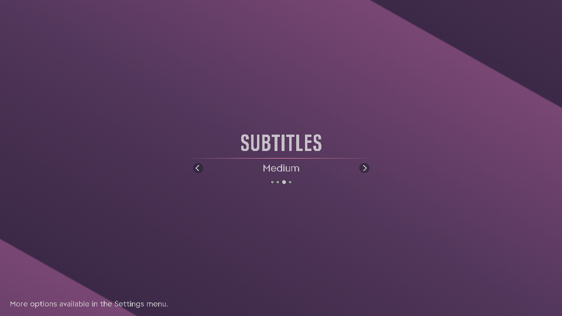
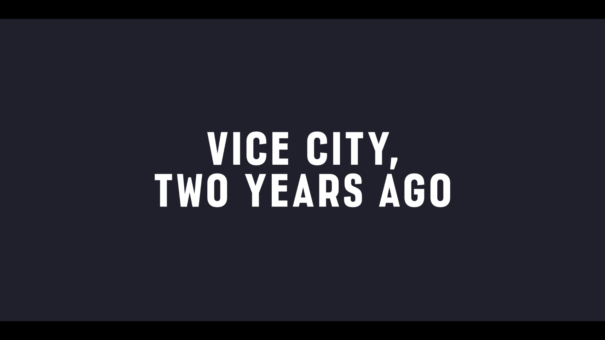
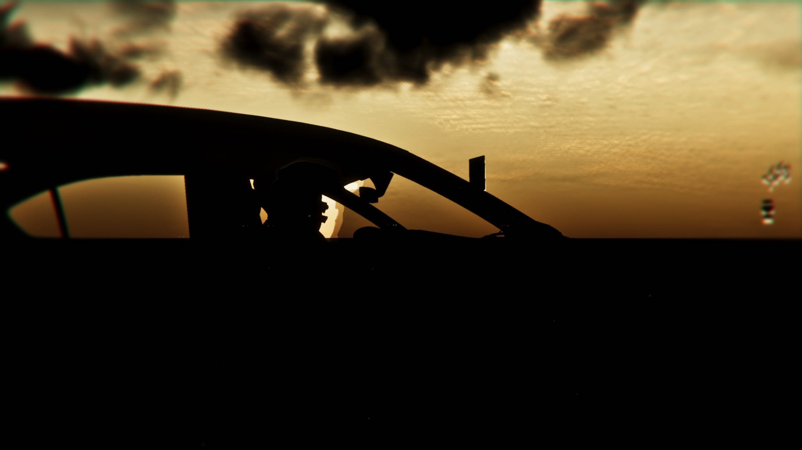

# ScarlettMac

[](#tested-on-mac)
[](#tested-on-mac)
[](#how-it-works)
[](#gta-vi-status)
[](#captured-on-mac)

ScarlettMac is an experimental Xbox Series X|S compatibility layer for Apple Silicon Macs, built on XCL and CrossOver. [XCL](https://github.com/xcl-dev/xcl)

## GTA VI status

**GTA VI reaches world loading through XCL on the M3 Max. The VIctory test rendered the opening 3D cinematic. Gameplay controls remain unverified.**

### Captured on Mac

**XCL** reached first-run setup and world loading on an M3 Max.

| Navigation settings | World loading |
| --- | --- |
| [](assets/captures/navigation-menu.png) | [](assets/captures/xcl-loading-artwork.png) |

| Subtitle settings | Finish Setup |
| --- | --- |
| [](assets/captures/subtitles-menu.png) | [](assets/captures/setup-menu.png) |

**VIctory** reached the opening title card and 3D cinematic in a separate Mac replay.

| Opening title card | Rendered 3D opening |
| --- | --- |
| [](assets/captures/opening-title-card.png) | [](assets/captures/opening-cinematic.png) |

[Replay details](docs/compatibility.md#victory-opening-cinematic)

### XCL launch milestones

<picture>
  <source media="(max-width: 480px) and (prefers-color-scheme: dark)" srcset="assets/gta-launch-milestones-mobile-dark.svg">
  <source media="(max-width: 480px) and (prefers-color-scheme: light)" srcset="assets/gta-launch-milestones-mobile-light.svg">
  <source media="(prefers-color-scheme: dark)" srcset="assets/gta-launch-milestones-dark.svg">
  <source media="(prefers-color-scheme: light)" srcset="assets/gta-launch-milestones-light.svg">
  
</picture>

[Compatibility measurements and reproduction steps](docs/compatibility.md)

## How it works

<picture>
  <source media="(prefers-color-scheme: dark)" srcset="assets/compatibility-flow-dark.svg">
  <source media="(prefers-color-scheme: light)" srcset="assets/compatibility-flow-light.svg">
  
</picture>

XCL supplies Xbox system services. Rosetta 2 runs the game’s x64 code, and D3DMetal runs the translated graphics on the Mac GPU.

## Tested on Mac

Apple M3 Max with CrossOver Preview 27.0.0.41073 and D3DMetal 4.0b3.

| Test | Result |
| --- | --- |
| GTA VI | Menus and world loading reached |
| Xbox system checks | 43 of 50 passed in all three runs |
| TuxBox Lanes | Scripted replay passed with input and rendered-board checks |

[Measurements, known issues, and reproduction steps](docs/compatibility.md)

## Build and run

Use an Apple Silicon Mac with CrossOver Preview and create a dedicated Windows 11 64-bit bottle named `ScarlettLab` with D3DMetal enabled. Keep the executable and accompanying unpacked game files together in their original directory structure. [CrossOver](https://www.codeweavers.com/crossover)

Install Rust through rustup, extract LLVM-MinGW 20261117 for macOS, and extract the x64 DLLs from a DirectX Shader Compiler release. The reported build used Rust 1.92.0. [Rust](https://rustup.rs/) · [LLVM-MinGW](https://github.com/mstorsjo/llvm-mingw/releases/tag/20261117) · [DXC](https://github.com/microsoft/DirectXShaderCompiler/releases)

```sh
rustup target add --toolchain stable x86_64-pc-windows-gnullvm
export SCARLETT_LLVM_MINGW=/path/to/llvm-mingw
export SCARLETT_DXC_DIR=/path/to/dxc/bin/x64
scripts/build.sh
scripts/run.sh --inspect /path/to/unpacked/game.exe
scripts/run.sh /path/to/unpacked/game.exe
```

Set `SCARLETT_BOTTLE_DIR` to use a dedicated bottle in another location. Set `SCARLETT_OPUS_DLL` to an x64 `libopus-0.dll` to enable the Opus decoder. The launcher stores local data in the bottle under `C:\scarlett-lab-data` and runs with outbound IP traffic disabled.

The repository distributes project source, patches, and launcher scripts. Supply your own unpacked game files. [Source provenance](SOURCE-NOTICES.md)

## Credits and license

This project builds on XCL by ivall and the macOS work by utkarshxdev. [ivall/xcl](https://github.com/ivall/xcl), [utkarshxdev/xcl-mac](https://github.com/utkarshxdev/xcl-mac)

The XCL-derived patches are distributed under GPL-2.0-only. See [LICENSE](LICENSE).
